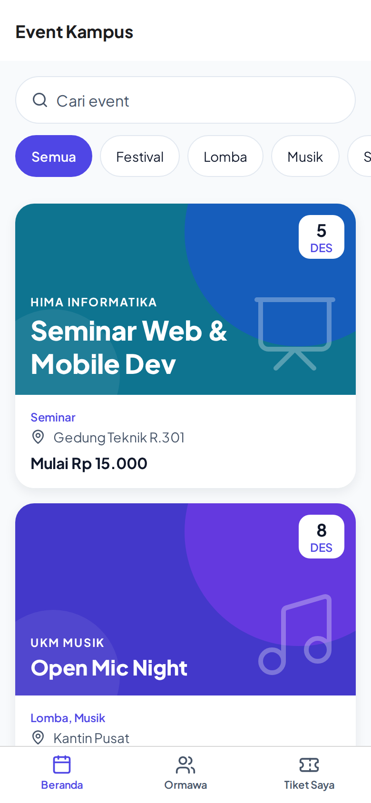
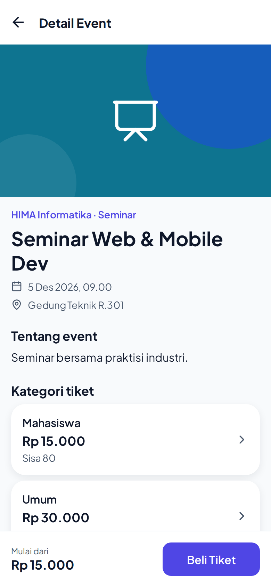
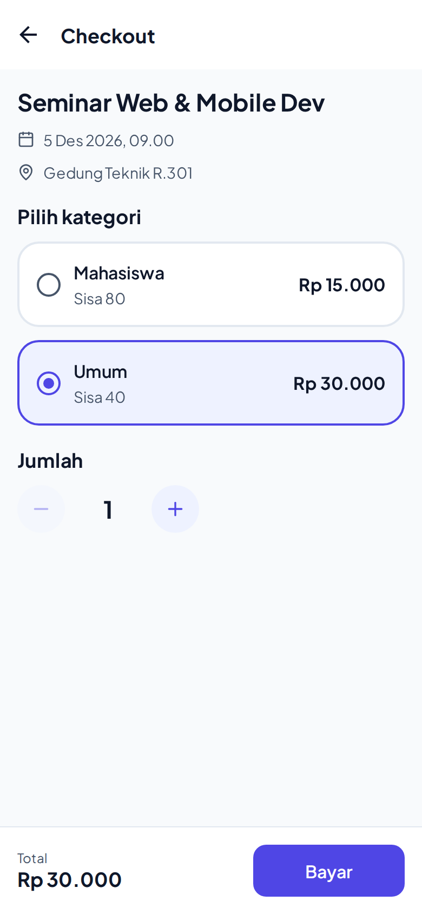
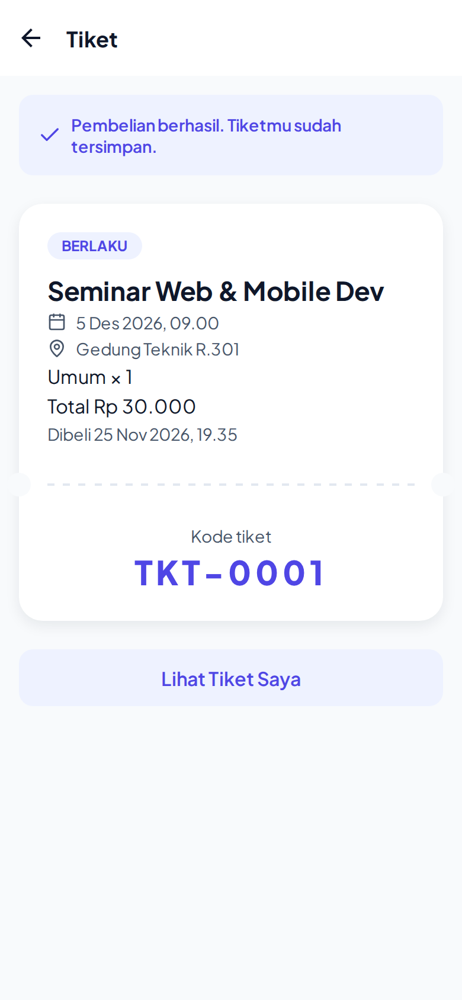
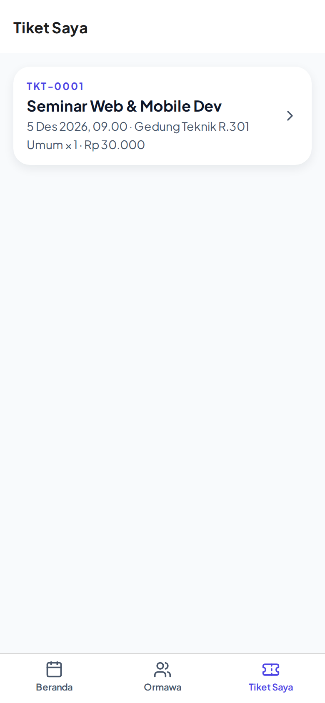
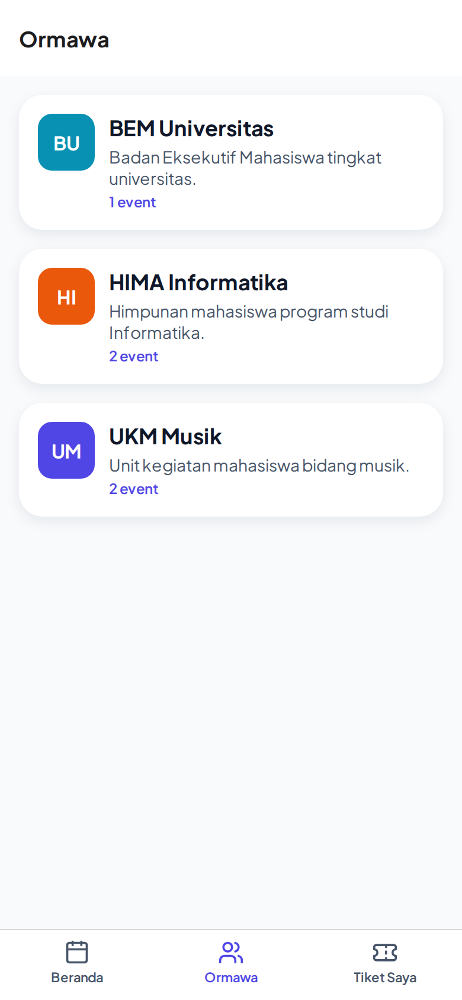
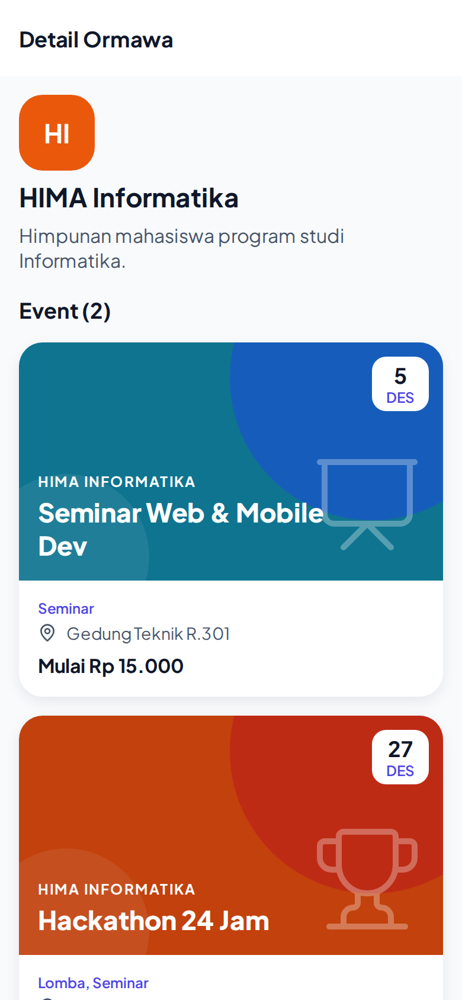

# OrmawaTicket

Aplikasi mobile lintas platform untuk **jual beli tiket kegiatan organisasi mahasiswa (ormawa)** di kampus. Pengguna dapat mencari event, memfilter menurut kategori, memilih jenis tiket, membeli tiket, dan melihat tiketnya.

Proyek ini dibuat untuk UTS mata kuliah _Aplikasi Berbasis Platform_ dengan **React Native + Expo** (JavaScript).

> Data bersifat statis dan fiktif, tanpa login dan tanpa pembayaran sungguhan. Tiket yang dibeli disimpan di memori, sehingga hilang saat aplikasi ditutup.

Repositori: <https://github.com/alumnicovids/OrmawaTicket>

## Fitur

- Daftar event diurutkan dari tanggal terdekat, dengan poster per kategori.
- Pencarian judul dan filter kategori. Satu event dapat memiliki lebih dari satu kategori.
- Detail event: tanggal, lokasi, ormawa penyelenggara, dan beberapa jenis tiket dengan sisa stok.
- Checkout: pilih jenis tiket dan jumlah. Jumlah dibatasi oleh sisa stok, dan stok berkurang setelah pembelian.
- Tiket: kode tiket, tanggal dan lokasi event, serta status **Berlaku** atau **Selesai**.
- Daftar ormawa beserta event yang mereka selenggarakan.
- Skeleton loading, keadaan kosong, pesan error dengan tombol "Coba lagi".

## Halaman dan navigasi

Navigasi memakai **Expo Router**: _Bottom Tab_ untuk menu utama dan _Stack_ untuk halaman detail.

| Halaman                | Rute                  | Navigasi   |
| ---------------------- | --------------------- | ---------- |
| Beranda (daftar event) | `/`                   | Bottom Tab |
| Ormawa                 | `/ormawa`             | Bottom Tab |
| Tiket Saya             | `/tickets`            | Bottom Tab |
| Detail Event           | `/event/[id]`         | Stack      |
| Checkout               | `/checkout/[eventId]` | Stack      |
| Detail Tiket           | `/ticket/[id]`        | Stack      |
| Detail Ormawa          | `/ormawa/[id]`        | Stack      |

Alur utama: **Beranda → Detail Event → Checkout → Detail Tiket → Tiket Saya**. Parameter yang dikirim antar halaman: `id`, `eventId`, `category` (jenis tiket yang dipilih lebih dulu), dan `new` (menampilkan pesan "Pembelian berhasil").

## Tangkapan layar

Pratinjau di bawah diambil dari build web pada ukuran 390×844. Tampilan di Expo Go dapat sedikit berbeda (bayangan dan safe area).

| Beranda                                     | Detail Event                                          | Checkout                                      | Detail Tiket                                          |
| ------------------------------------------- | ----------------------------------------------------- | --------------------------------------------- | ----------------------------------------------------- |
|  |  |  |  |

| Tiket Saya                                        | Ormawa                                    | Detail Ormawa                                           |
| ------------------------------------------------- | ----------------------------------------- | ------------------------------------------------------- |
|  |  |  |

## Arsitektur

Struktur mengikuti **Clean Architecture** dengan prinsip **SOLID**. Arah ketergantungan: `presentation → domain ← data`. Lapisan `domain` tidak mengimpor apa pun dari React Native atau lapisan lain.

```
src/
├── app/            Rute Expo Router (file tipis, hanya merender screen)
│   ├── (tabs)/       Bottom Tab: Beranda, Ormawa, Tiket Saya
│   └── event/ checkout/ ticket/ ormawa/   Stack: halaman detail
├── domain/         Aturan bisnis, tanpa ketergantungan ke framework
│   ├── repositories/ Kontrak (EventRepository, OrmawaRepository, TicketRepository)
│   ├── usecases/     SearchEvents, PurchaseTicket, GetEventById, ...
│   └── rules/        ticketStatus (berlaku atau selesai)
├── data/           Implementasi repository dan data statis
│   ├── sources/      events.js, ormawa.js, eventCategories.js
│   └── repositories/ *RepositoryImpl (data event di memori, tiket di memori)
├── di/             container.js: satu-satunya tempat yang tahu implementasi konkret
└── presentation/   UI
    ├── screens/      7 screen
    ├── components/   Button, Card, Chip, EventCard, EventPoster, Skeleton, ...
    ├── hooks/        useAsync (memuat data, retry, muat ulang saat layar fokus)
    ├── theme.js      Warna, spasi, radius, font (satu sumber)
    └── format.js     Format rupiah, tanggal, label kategori
```

Penerapan SOLID: satu use case untuk satu aksi (S), data baru berarti repository baru tanpa mengubah use case dan UI (O), repository dapat saling menggantikan (L), kontrak dipisah per agregat (I), use case menerima repository lewat constructor dan hanya `di/container.js` yang memilih implementasi (D).

## Teknologi

|                    |                                                            |
| ------------------ | ---------------------------------------------------------- |
| Framework          | React Native 0.88, Expo SDK 58, React 19                   |
| Navigasi           | Expo Router (Bottom Tab + Stack)                           |
| Bahasa             | JavaScript (JSX)                                           |
| Gambar | `expo-image` |
| Ikon               | `lucide-react-native` + `react-native-svg`                 |
| Font               | Plus Jakarta Sans (`@expo-google-fonts/plus-jakarta-sans`) |
| Pengelola paket    | Bun                                                        |
| Tes                | `bun test`                                                 |

## Menjalankan aplikasi

Prasyarat: [Bun](https://bun.sh), dan aplikasi **Expo Go** di HP (atau emulator Android Studio / iOS Simulator).

```bash
git clone https://github.com/alumnicovids/OrmawaTicket.git
cd OrmawaTicket
bun install
bunx expo start
```

Pindai kode QR dengan Expo Go. Perintah lain:

```bash
bunx expo start --android   # emulator Android
bunx expo start --ios       # iOS Simulator
bunx expo start --web       # pratinjau di browser
bun run test                # menjalankan tes
bunx expo-doctor            # memeriksa konfigurasi dan dependensi
```

Jika HP dan komputer tidak berada di jaringan yang sama (atau memakai WSL2), jalankan `bunx expo start --tunnel`.

## Palet warna

Semua warna didefinisikan di [`src/presentation/theme.js`](src/presentation/theme.js).

| Peran                      | Hex       | Nama di kode                     |
| -------------------------- | --------- | -------------------------------- |
| Primary                    | `#4F46E5` | `theme.primary`                  |
| Secondary (latar lembut)   | `#EEF2FF` | `theme.primarySoft`              |
| Background                 | `#F8FAFC` | `theme.bg`                       |
| Surface (kartu)            | `#FFFFFF` | `theme.card`                     |
| Text                       | `#0F172A` | `theme.text`                     |
| Text redup                 | `#475569` | `theme.muted`                    |
| Border / skeleton          | `#E2E8F0` | `theme.border`, `theme.skeleton` |
| Warning (stok menipis)     | `#B45309` | `theme.warning`                  |
| Danger (error, stok habis) | `#DC2626` | `theme.danger`                   |

Warna poster per kategori dan avatar ormawa juga ada di `theme.js`:

| Kategori | Warna dasar | Aksen     |
| -------- | ----------- | --------- |
| Musik    | `#4338CA`   | `#7C3AED` |
| Seminar  | `#0E7490`   | `#1D4ED8` |
| Lomba    | `#C2410C`   | `#B91C1C` |
| Festival | `#A21CAF`   | `#BE185D` |

Avatar ormawa: `#4F46E5`, `#0891B2`, `#C026D3`, `#EA580C`, `#16A34A`.

Pasangan teks dan latar utama dirancang memenuhi kontras WCAG AA (4,5:1).

## Sumber dan lisensi aset

| Aset                      | Sumber                                                                                                                                                                                                                                                                                       | Lisensi                                 |
| ------------------------- | -------------------------------------------------------------------------------------------------------------------------------------------------------------------------------------------------------------------------------------------------------------------------------------------- | --------------------------------------- |
| Ikon antarmuka            | [Lucide](https://lucide.dev) lewat `lucide-react-native` 1.78                                                                                                                                                                                                                                | ISC                                     |
| Ikon aplikasi (`assets/`) | Dibuat sendiri dari glyph _Ticket_ Lucide di atas latar indigo                                                                                                                                                                                                                               | ISC (glyph), karya sendiri              |
| Font Plus Jakarta Sans    | [Google Fonts](https://fonts.google.com/specimen/Plus+Jakarta+Sans) lewat `@expo-google-fonts/plus-jakarta-sans`                                                                                                                                                                             | SIL Open Font License 1.1               |
| Poster event              | Dibuat dengan kode (warna dasar, lingkaran, ikon). Tidak memakai foto                                                                                                                                                                                                                            | Karya sendiri                           |
| Data event dan ormawa     | Fiktif, ditulis sendiri di `src/data/sources/`                                                                                                                                                                                                                                               | Karya sendiri                           |
| Template awal proyek      | Template Expo (`create-expo-app`)                                                                                                                                                                                                                                                            | MIT, © 650 Industries (lihat `LICENSE`) |
| Library                   | `expo`, `expo-router`, `expo-image`, `expo-font`, `expo-status-bar`, `expo-constants`, `expo-linking`, `react`, `react-dom`, `react-native`, `react-native-web`, `react-native-svg`, `react-native-screens`, `react-native-safe-area-context`, `@expo/metro-runtime` | MIT                                     |

`react-dom`, `react-native-web` dan `@expo/metro-runtime` hanya dipakai untuk pratinjau web.

## Lisensi

Kode mengikuti lisensi MIT pada berkas [`LICENSE`](LICENSE).
